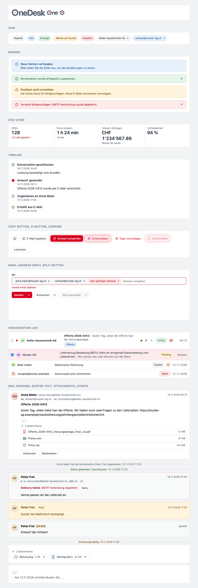
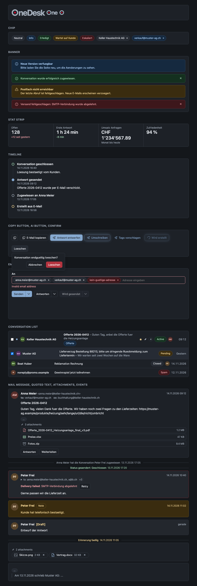

# bmsuisse/bmsui-blade

The BMS design as **Blade components** for PHP/Laravel apps (OneDesk/FreeScout, any Laravel 11/12 app):
the same look as the React [`@bmsuisse/ui`](../../packages/ui), as plain CSS + a little vanilla JS.
**No build step, no Tailwind, no jQuery dependency**, and it coexists with Bootstrap 3. Colours are CSS
variables (`--bmsui-*`); a `.dm` class on `<body>` switches to night mode (FreeScout/BMS Design already sets it).

| Component | Usage |
|---|---|
| Chip | `<x-bmsui::chip tone="success" href="/x" removable>Text</x-bmsui::chip>` (`neutral`, `info`, `success`, `warning`, `danger`) |
| Banner | `<x-bmsui::banner tone="warning" title="Title" dismissible>Text</x-bmsui::banner>` |
| Stat strip | `<x-bmsui::stat-strip><x-bmsui::stat label="Open" value="128" sub="+12" trend="down"/></x-bmsui::stat-strip>` |
| Timeline | `<x-bmsui::timeline><x-bmsui::timeline-item title="Assigned" time="14.11.2026 09:12" tone="accent">Body</x-bmsui::timeline-item></x-bmsui::timeline>` |
| Copy button | `<x-bmsui::copy-button value="OFF-1" label="Copy"/>` (no `label` = icon only, set `aria-label`) |
| Confirm popover | `<x-bmsui::confirm action="{{ route('x.destroy', $x) }}" method="DELETE" message="Really delete?">Delete</x-bmsui::confirm>`; without `action` it fires a `bmsui:confirm` event |
| AI button | `<x-bmsui::ai-button variant="subtle" :loading="$busy">Draft reply</x-bmsui::ai-button>` (`solid`, `subtle`, `ghost`; theme accent with a soft glow) |
| Brand logo | `<x-bmsui::brand product="Desk" :size="32" :animate="true"/>` (`mode`: `full`, `one`, `mark`) |
| Email address input | `<x-bmsui::email-address-input name="to" :value="$to" :max-items="10" :suggestions="[['email' => 'a@b.ch', 'name' => 'Anna']]"><x-slot:label>To</x-slot:label></x-bmsui::email-address-input>`; chips with a hidden field `name` (comma-joined), Enter/`,`/`;`/space/Tab/blur/paste commit, invalid addresses become red chips, Backspace removes the last; fires `bmsui:change` |
| Split button | `<x-bmsui::split-button :items="[['id' => 'close', 'label' => 'Send & close'], ['id' => 'x', 'label' => 'Link', 'href' => '/x']]" variant="default" type="submit" name="act" value="send">Send</x-bmsui::split-button>`; item buttons fire `bmsui:select` (`detail.id`); `variant`: `default`, `outline`, `secondary`; `top`, `end`, `loading` |
| Conversation list / row | `<x-bmsui::conversation-list><x-bmsui::conversation-row subject="Offerte" preview="..." href="/c/1" :customer="['name' => 'Keller AG']" :assignee="['name' => 'Anna']" status="active" :unread="true" :starred="true" :thread-count="3" :has-attachments="true" time="09:12" :selected="false"><x-bmsui::chip>Tag</x-bmsui::chip></x-bmsui::conversation-row></x-bmsui::conversation-list>` (`status`: `active`, `pending`, `closed`, `spam`; omit `selected` for no checkbox; the tags slot stays clickable) |
| Attachment list | `<x-bmsui::attachment-list :attachments="[['id' => 1, 'name' => 'Offerte.pdf', 'size' => 1258291, 'mimeType' => 'application/pdf', 'href' => '/d/1']]" layout="chips" :removable="true"/>` (`BMSUi::formatFileSize()` is available too) |
| Quoted text | `<x-bmsui::quoted-text :open="false">On 14.11.2026, X wrote: ...</x-bmsui::quoted-text>` |
| Mail message | `<x-bmsui::mail-message direction="inbound" :sender="['name' => 'Anna', 'email' => 'a@b.ch']" :recipients="['to' => [...], 'cc' => [...]]" time="14.11.2026 09:12" subject="..." status="failed" error="SMTP" retry-href="/r" :attachments="$files">{!! $sanitizedBody !!}<x-slot:quoted>...</x-slot:quoted><x-slot:actions>...</x-slot:actions><x-slot:badges>...</x-slot:badges></x-bmsui::mail-message>` (`direction`: `inbound`, `outbound`, `note`; `status`: `sent`, `sending`, `failed`, `bounced`, `draft`; the body slot is not sanitized, pass trusted HTML only) |
| Mail event | `<x-bmsui::mail-event tone="success" time="14.11.2026 17:20">Status changed to Closed</x-bmsui::mail-event>` |

All texts are props (defaults go through `__()`, and de/fr/it/nl/es translations ship in `resources/lang/*.json`, loaded automatically with the app locale; FreeScout modules register `BMSUi::langPath()`), all content is escaped. Behaviour is delegated
(`resources/js/bmsui.js`), so HTML added later (ajax) just works.





## Install (Laravel)

```bash
composer require bmsuisse/bmsui-blade
php artisan vendor:publish --tag=bmsui-assets   # copies bmsui.css / bmsui.js to public/vendor/bmsui
```

```blade
<head> @bmsuiAssets("css") </head>
<body> ... @bmsuiAssets("js") </body>   {{-- or a single @bmsuiAssets for both --}}
```

Until it is on Packagist/your feed, require it from the repo with a `path` or `vcs` repository entry
pointing at `php/bmsui-blade`.

## OneDesk / FreeScout

FreeScout has its own asset pipeline, so a module registers the two files through its hooks instead of
`@bmsuiAssets`. Put this in a module's service provider (e.g. in `BMSDesign`) after `composer require`:

```php
use BMSuisse\BMSUi\BMSUi;

\Eventy::addFilter('stylesheets', fn ($s) => array_merge($s, [BMSUi::cssPath()]));
\Eventy::addFilter('javascripts', fn ($j) => array_merge($j, [BMSUi::jsPath()]));
```

If your asset pipeline needs files under `public/`, publish them (`--tag=bmsui-assets`) and use those
paths. Night mode follows automatically because BMS Design adds `.dm` to `<body>`. The components
render with Bootstrap 3 loaded (`box-sizing`, link and button resets are handled).

## Preview and tests

`view('bmsui::preview')` renders every component (pass `['dark' => true]` for night mode); mount it behind
your own auth on a route to review them.

```bash
composer install
vendor/bin/phpunit
```

## Keeping it in sync with the React library

The design tokens, tones and the AI glow recipe come from `packages/ui`. When a component's look changes
there, change the matching class in `resources/css/bmsui.css`; the screenshots in `docs/` come from
`view('bmsui::preview')`.
