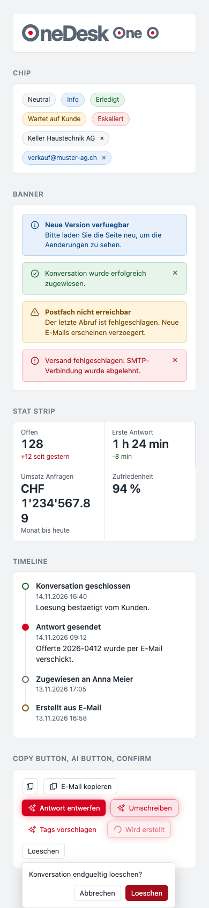

# bmsuisse/bmsui-blade

The BMS design as **Blade components** for PHP/Laravel apps (OneDesk/FreeScout, any Laravel 11/12 app):
the same look as the React [`@bmsuisse/ui`](../../packages/ui), as plain CSS + a little vanilla JS.
**No build step, no Tailwind, no jQuery dependency**, and it coexists with Bootstrap 3. Colours are CSS
variables (`--bmsui-*`); a `.dm` class on `<body>` switches to night mode (FreeScout/BMS Design already sets it).

| Component | Usage |
|---|---|
| Chip | `<x-bmsui::chip tone="success" href="/x" removable>Text</x-bmsui::chip>` (`neutral`, `info`, `success`, `warning`, `danger`) |
| Banner | `<x-bmsui::banner tone="warning" title="Title" dismissible>Text</x-bmsui::banner>` |
| Stat strip | `<x-bmsui::stat-strip><x-bmsui::stat label="Open" value="128" sub="+12" trend="down"/></x-bmsui::stat-strip>` |
| Timeline | `<x-bmsui::timeline><x-bmsui::timeline-item title="Assigned" time="14.11.2026 09:12" tone="accent">Body</x-bmsui::timeline-item></x-bmsui::timeline>` |
| Copy button | `<x-bmsui::copy-button value="OFF-1" label="Copy"/>` (no `label` = icon only, set `aria-label`) |
| Confirm popover | `<x-bmsui::confirm action="{{ route('x.destroy', $x) }}" method="DELETE" message="Really delete?">Delete</x-bmsui::confirm>`; without `action` it fires a `bmsui:confirm` event |
| AI button | `<x-bmsui::ai-button variant="subtle" :loading="$busy">Draft reply</x-bmsui::ai-button>` (`solid`, `subtle`, `ghost`; theme accent with a soft glow) |
| Brand logo | `<x-bmsui::brand product="Desk" :size="32" :animate="true"/>` (`mode`: `full`, `one`, `mark`) |
| Email address input | `<x-bmsui::email-address-input name="to" :value="$to" :max-items="10" :suggestions="[['email' => 'a@b.ch', 'name' => 'Anna']]"><x-slot:label>To</x-slot:label></x-bmsui::email-address-input>`; chips with a hidden field `name` (comma-joined), Enter/`,`/`;`/space/Tab/blur/paste commit, invalid addresses become red chips, Backspace removes the last; fires `bmsui:change` |
| Split button | `<x-bmsui::split-button :items="[['id' => 'close', 'label' => 'Send & close'], ['id' => 'x', 'label' => 'Link', 'href' => '/x']]" variant="default" type="submit" name="act" value="send">Send</x-bmsui::split-button>`; item buttons fire `bmsui:select` (`detail.id`); `variant`: `default`, `outline`, `secondary`; `top`, `end`, `loading` |
| Conversation list / row | `<x-bmsui::conversation-list><x-bmsui::conversation-row subject="Offerte" preview="..." href="/c/1" :customer="['name' => 'Keller AG']" :assignee="['name' => 'Anna']" status="active" :unread="true" :starred="true" :thread-count="3" :has-attachments="true" time="09:12" :selected="false"><x-bmsui::chip>Tag</x-bmsui::chip></x-bmsui::conversation-row></x-bmsui::conversation-list>` (`status`: `active`, `pending`, `closed`, `spam`; omit `selected` for no checkbox; the tags slot stays clickable) |
| Attachment list | `<x-bmsui::attachment-list :attachments="[['id' => 1, 'name' => 'Offerte.pdf', 'size' => 1258291, 'mimeType' => 'application/pdf', 'href' => '/d/1']]" layout="chips" :removable="true"/>` (`BMSUi::formatFileSize()` is available too) |
| Quoted text | `<x-bmsui::quoted-text :open="false">On 14.11.2026, X wrote: ...</x-bmsui::quoted-text>` |
| Mail message | `<x-bmsui::mail-message direction="inbound" :sender="['name' => 'Anna', 'email' => 'a@b.ch']" :recipients="['to' => [...], 'cc' => [...]]" time="14.11.2026 09:12" subject="..." status="failed" error="SMTP" retry-href="/r" :attachments="$files">{!! $sanitizedBody !!}<x-slot:quoted>...</x-slot:quoted><x-slot:actions>...</x-slot:actions><x-slot:badges>...</x-slot:badges></x-bmsui::mail-message>` (`direction`: `inbound`, `outbound`, `note`; `status`: `sent`, `sending`, `failed`, `bounced`, `draft`; the body slot is not sanitized, pass trusted HTML only) |
| Mail event | `<x-bmsui::mail-event tone="success" time="14.11.2026 17:20">Status changed to Closed</x-bmsui::mail-event>` |
| Button | `<x-bmsui::button variant="primary" size="md" type="submit" :loading="$busy">Save<x-slot:start><svg .../></x-slot:start></x-bmsui::button>` (`variant`: `primary`, `secondary`, `outline`, `ghost`, `link`, `danger`; `size`: `xs`, `sm`, `md`, `lg`; `:icon="true"` square icon-only button (set `aria-label`); `href` renders an `<a>`, disabled links lose their `href`) |
| Form field, label, input, textarea | `<x-bmsui::form-field label="Subject" for="subject" help="Shown in the list" :error="$errors->first('subject')" :required="true"><x-bmsui::input name="subject" :value="old('subject')"/></x-bmsui::form-field>`; the control takes the field's `for` as its id and gets `aria-describedby`/`aria-invalid`; `layout="horizontal"` puts the label in a column on wide screens; `<x-bmsui::textarea :auto-resize="true" :max-rows="8">`; `<x-bmsui::label for="x" :required="true">` on its own |
| Select | `<x-bmsui::select name="mailbox" :value="$id" placeholder="Choose" :options="['1' => 'Sales', 'Archive' => ['9' => 'Old']]"/>` (native `<select>`; nested arrays become `<optgroup>`, `multiple` works, extra `<option>`s in the slot) |
| Checkbox, switch, radio group | `<x-bmsui::checkbox name="notify" label="Notify" description="By mail" :checked="true" :indeterminate="false"/>`, `<x-bmsui::switch name="auto" label="Auto reply"/>` (`role="switch"`), `<x-bmsui::radio-group name="prio" label="Priority" value="normal" orientation="horizontal" :options="['low' => 'Low', 'normal' => 'Normal']"/>`; all native inputs, same `name`/`value` as before |
| Combobox, tag combobox | `<x-bmsui::combobox name="customer_id" :value="$id" :selected="[['value' => $id, 'label' => $name]]" search-url="/customers/ajax-search" :min-chars="2" placeholder="Search"/>` (replaces select2: a hidden field `name`; `:options` are filtered in the browser, `search-url` asks the server with `q` (or `{q}` in the URL) and reads `[{value, label, description}]` or select2's `{results: [{id, text}]}`); `<x-bmsui::tag-combobox name="tags" :value="$tags" search-url="/tags/search"/>` posts `tags[]`, chips, Enter on free text adds a tag (`:creatable="false"` to forbid), Backspace removes the last; `:multiple="true"` on the combobox does the same without free text; listbox keyboard, `aria-activedescendant`, fires `bmsui:change` |
| Dialog, modal, confirm dialog | `<x-bmsui::dialog id="move" title="Move" description="..." size="md" url="/conversations/5/move">Loading…<x-slot:footer>...</x-slot:footer></x-bmsui::dialog>` + `<button data-bmsui-dialog-open="#move">`; native `<dialog>` with `showModal()` (page inert, focus inside, back to the opener on close), Escape and backdrop close (`:static="true"` keeps it open on backdrop clicks), `url` loads the body by ajax on every open, `data-bmsui-dialog-close` buttons close it with their `value` as `returnValue`; `size`: `sm`, `md`, `lg`, `xl`; `<x-bmsui::modal>` is the same; any link with `data-bmsui-dialog-url="/x" data-bmsui-dialog-title="X"` opens a shared ajax dialog (render `<x-bmsui::dialog id="bmsui-remote"/>` once for translated labels); JS: `BMSUi.dialog.open('move')`, `.close('move', 'value')`, `.load('move', url)`; events `bmsui:open`, `bmsui:close` (`detail.returnValue`), `bmsui:loaded`. `<x-bmsui::confirm-dialog id="del" title="Delete?" message="..." action="/x/5" method="DELETE"/>` (without `action`: `bmsui:confirm`); `await BMSUi.confirm('Really?', {title, confirmLabel, cancelLabel})` resolves `true`/`false` (uses `<x-bmsui::confirm-dialog id="bmsui-confirm"/>` when the layout renders it) |
| Tabs | `<x-bmsui::tabs label="Settings" active="general" :tabs="[['id' => 'general', 'label' => 'General'], ['id' => 'mail', 'label' => 'Mailboxes', 'count' => 4]]"><x-bmsui::tab-panel id="general">...</x-bmsui::tab-panel><x-bmsui::tab-panel id="mail">...</x-bmsui::tab-panel></x-bmsui::tabs>` (arrow keys, Home/End, `bmsui:tab`); with `href` on the tabs they are links to server pages (`aria-current`) |
| Tooltip, popover | `<x-bmsui::tooltip text="Assign" side="bottom"><button>…</button></x-bmsui::tooltip>`, or `data-bmsui-tooltip="Assign"` on any element (hover and focus, flips at the edge, Escape hides); `<x-bmsui::popover title="Customer" align="end" :width="280"><x-slot:trigger>Info</x-slot:trigger>Content</x-bmsui::popover>` (click, outside click/Escape close) |
| Dropdown menu | `<x-bmsui::dropdown-menu label="Actions" align="end" :items="[['id' => 'fwd', 'label' => 'Forward', 'shortcut' => 'F'], ['separator' => true], ['heading' => 'Move'], ['label' => 'Move to', 'items' => [['id' => 'inbox', 'label' => 'Inbox']]], ['id' => 'del', 'label' => 'Delete', 'danger' => true]]"/>`; buttons fire `bmsui:select` (`detail.id`), links navigate; arrow keys, Home/End, type-ahead, submenus (ArrowRight/Left), Escape; `trigger` slot for own trigger content, `variant` for the trigger look |

All texts are props (defaults go through `__()`, and de/fr/it/nl/es translations ship in `resources/lang/*.json`, loaded automatically with the app locale; FreeScout modules register `BMSUi::langPath()`), all content is escaped. Behaviour is delegated
(`resources/js/bmsui.js`), so HTML added later (ajax) just works.

The few behaviours that need a setup step (indeterminate checkboxes, auto-resizing textareas, tab panel ids,
⌘ on Apple key caps, dialogs rendered open) run for inserted nodes via a `MutationObserver`;
`window.BMSUi.init(container)` does the same by hand.




## OneDesk / FreeScout extension points

The list and the thread view can replace FreeScout's markup without breaking its hooks and jQuery selectors:

| FreeScout | bmsui-blade |
|---|---|
| `tr.conv-row[data-conversation_id]`, `row_class` | attributes on `<x-bmsui::conversation-row>` go on the row (`class="conv-row" data-conversation_id="5"`) |
| `.conv-checkbox`, `.conv-star` | `:checkbox-attributes="['class' => 'conv-checkbox', 'data-conversation_id' => 5]"`, `:star-attributes`, `:link-attributes` (merged with ours) |
| `before_subject`, `after_subject`, `preview_prepend`, `td_before_conv_number`, `after_row` | slots `before-subject`, `after-subject`, `before-preview` (inside the link: text/icons only), `before-number` (+ `:number="1234"`), `after-row` |
| `.table-conversations`, `<td>` hooks | `<x-bmsui::conversation-list as="table">`: same look as `<table>/<tr>/<td>`; in table mode `before-number` and `after-row` are raw markup inside/after the `<tr>` |
| `.toggle-all`, sorting | `:select-all="false" :select-all-attributes="['class' => 'toggle-all']"` (toggles the row checkboxes, sets indeterminate, fires `bmsui:select-all`); `:sorts="[['key' => 'date', 'label' => 'Date', 'dir' => 'desc', 'href' => '?sort=date']]"` (without `href`: `bmsui:sort` with `detail.key`/`detail.dir`); `header` slot for bulk actions |
| `.table-pager .pager-nav`, count | `:count="128"` ("128 conversations"), `pager` and `footer` slots |
| star toggle | `:starrable="true"`: a button with `aria-pressed`; a click flips it and fires `bmsui:star` (`detail.starred`, cancelable: `preventDefault()` reverts) |
| `thread.meta`, `thread.action_text`, "…" menu, thread id | `<x-bmsui::mail-message :thread-id="$t->id" :menu-items="[...]">` with slots `meta`, `action-text`, `menu` (own markup instead of `menu-items`), `badges`, `actions` |
| draft / note / line item | `status="draft"`, `direction="note"`, line items are `<x-bmsui::mail-event :thread-id="...">` |
| `conversation.after_subject_block`, `conversation.action_buttons` | slots of the page header (see Page header) |

**Blade tip:** when a named slot comes first, put a line break after its closing tag
(`<x-slot:trigger>Info</x-slot:trigger>` then content on the next line). Text directly after `</x-slot:…>`
in that position leaves an open output buffer in Laravel 12's compiler (true for every component).

## Install (Laravel)

```bash
composer require bmsuisse/bmsui-blade
php artisan vendor:publish --tag=bmsui-assets   # copies bmsui.css / bmsui.js to public/vendor/bmsui
```

```blade
<head> @bmsuiAssets("css") </head>
<body> ... @bmsuiAssets("js") </body>   {{-- or a single @bmsuiAssets for both --}}
```

Until it is on Packagist/your feed, require it from the repo with a `path` or `vcs` repository entry
pointing at `php/bmsui-blade`.

## OneDesk / FreeScout

FreeScout has its own asset pipeline, so a module registers the two files through its hooks instead of
`@bmsuiAssets`. Put this in a module's service provider (e.g. in `BMSDesign`) after `composer require`:

```php
use BMSuisse\BMSUi\BMSUi;

\Eventy::addFilter('stylesheets', fn ($s) => array_merge($s, [BMSUi::cssPath()]));
\Eventy::addFilter('javascripts', fn ($j) => array_merge($j, [BMSUi::jsPath()]));
```

If your asset pipeline needs files under `public/`, publish them (`--tag=bmsui-assets`) and use those
paths. Night mode follows automatically because BMS Design adds `.dm` to `<body>`. The components
render with Bootstrap 3 loaded (`box-sizing`, link and button resets are handled).

## Preview and tests

`view('bmsui::preview')` renders every component (pass `['dark' => true]` for night mode); mount it behind
your own auth on a route to review them.

```bash
composer install
vendor/bin/phpunit
```

## Keeping it in sync with the React library

The design tokens, tones and the AI glow recipe come from `packages/ui`. When a component's look changes
there, change the matching class in `resources/css/bmsui.css`; the screenshots in `docs/` come from
`view('bmsui::preview')`.
